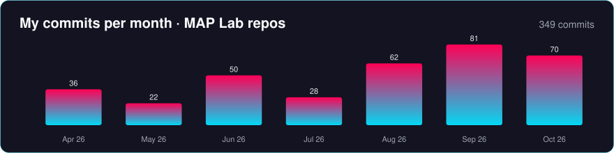
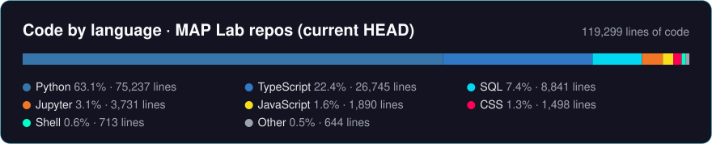

  

<h1 align="center">
  Hi , I'm Jackson Zhao
</h1>

  <strong>Research Software Engineer</strong> · <a href="https://maplab-web.vercel.app/">Motivational and Affective Psychopathology (MAP) Lab</a> · <strong>Icahn School of Medicine at Mount Sinai</strong>

  I build the pipelines, databases, and tools that move EEG, behavioral-task, and clinical data 
  from collection to analysis for addiction neuroscience research.

  
  
  

  
  
  

## About 🧠

The MAP Lab, directed by Dr. Muhammad A. Parvaz, studies how emotion and motivation shape reward learning and self-control in substance use disorders. As the lab's research software engineer, I own its research data systems end to end:

- **EEG:** the lab's sensor-level preprocessing pipeline, QC reports, and source-analysis integration (MNE-Python)
- **Data platform:** the database that links Pavlovia behavioral tasks to REDCap participant records
- **Study tooling:** REDCap tooling and reporting, the lab website, and an engineering hub for weekly reporting
- **ML datasets:** ABCD Study variable curation and synthetic-EEG experiments

## By the Numbers 📈

<!-- STATS:START -->

  
  
  
  
  

| Repo | Area | My commits | Lines I added / removed | Code at HEAD | Active |
|---|---|--:|--:|--:|---|
| `MAPLAB_MNE` | EEG pipeline | 136 | +56,852 / −14,993 | 36,779 | 2026-04 → 2026-10 |
| `MAPLAB_Database` | Data platform | 76 | +82,772 / −24,350 | 54,513 | 2026-06 → 2026-10 |
| `maplab_web` | Lab website | 64 | +11,493 / −4,498 | 6,447 | 2026-06 → 2026-10 |
| `Synthetic_EEG_Cocaine` | Synthetic EEG | 35 | notebooks¹ | 3,731 | 2026-04 → 2026-04 |
| `engineerhub` | MAPLAB Hub | 19 | +13,242 / −180 | 11,894 | 2026-09 → 2026-10 |
| `abcd-engine` | ABCD / ML | 7 | +7,815 / −6,672 | 1,067 | 2026-08 → 2026-10 |
| `ReMAP` | Cloud app | 5 | +309 / −0 | 246 | 2026-05 → 2026-05 |
| `aible_ABCD` | ABCD / ML | 4 | +79 / −0 | 64 | 2026-05 → 2026-06 |
| `redcap-config` | REDCap config | 3 | +464 / −0 | 398 | 2026-09 → 2026-10 |

<b>Live:</b> recomputed from the private GitHub repos within minutes of every push · data as of 2026-10-30 07:34 ET · <a href="./stats/AUDIT.md">audit ledger</a> (every commit audited, where every line went, flags) · method: <a href="./scripts/update_stats.py"><code>update_stats.py</code></a>. Counts are my non-merge commits; lines are source code I wrote, with docs, data, outputs, backups, generated files and colleagues' code excluded. ¹ Notebook repos count code-cell lines at HEAD only.
<!-- STATS:END -->

## Systems I Build at MAP Lab 🛠️

> Lab repositories are private because they sit next to participant data and IRB-governed workflows. Every description below reflects what is in the code as of **October 2026**.

### EEG & Neuroscience

**`MAPLAB_MNE` · EEG preprocessing, QC, and source-analysis pipeline**
- Python/MNE-Python pipeline (`python -m src.main`) with a typed stage chain, one artifact-writing gateway, strict config access, and one config overlay per task.
- **Running in production** on a 39-participant cocaine-use-disorder cohort across all five lab tasks: Reappraisal, Flanker, Gambling, RSVP, and Resting state (eyes open/closed).
- Validated against a frozen reference: **34/34 sessions** of the original Reappraisal cohort reproduce epochs, ICA, ERP features, bad-channel decisions, and QC figures **byte-for-byte**. Later refactors are re-verified as byte-identical on a 5-task × 5-session mini-batch.
- QC reports v2.1 (single-participant and batch PDFs under an enforced figure-style gate), a GradeCard data-quality score, and integration of a collaborator's source-space toolkit (source power, time-frequency, dwPLI connectivity) through a five-task handshake.
- Engineering safety net: **47 pytest modules**, 15 standing gate commands, data-free CI checks, provenance recorded for every run, and a guard for Apple-silicon floating-point flags in ICA.

**`Synthetic_EEG_Cocaine` · Synthetic EEG experiments (Apr 2026)**
- Five-notebook study comparing six generators (GAN baselines, WGAN-GP variants, DDPM, and conditional diffusion) on band-power features, scored with TSTR/TRTR, real-vs-synthetic AUC, and PERMANOVA.
- Best model (calibrated WGAN-GP on CLR-transformed features) cut the TSTR/TRTR gap from 0.26 to 0.03. Synthetic samples are still separable from real ones (AUC 1.0), so this is an augmentation result, not a realism claim.

### Research Data Platform

**`MAPLAB_Database` · Pavlovia ↔ REDCap linkage platform**
- Read-only pull of the study's REDCap project and five Pavlovia tasks into PostgreSQL. A PHI denylist drops identifying fields before anything is stored.
- Three-step matching (participant ID → visit → timestamp). Anything unresolved goes to a review site (Next.js on Vercel) where reviewers click through grouped "Needs Review" folders, the PI and study coordinator approve, and the result becomes the **Matched Data** set that every export reads.
- Daily 08:00 sync from GitHub Actions or any lab laptop into a shared Neon database, serialized with an advisory lock. Local Postgres stays available for direct SQL inspection.
- Approved corrections are queued for write-back to the source systems only after sign-off. The same layer also feeds rerunnable analysis and thesis exports.

**`engineerhub` · MAPLAB Engineering Hub**
- Vite + React dashboard on Vercel with five tabs: weekly report, application catalog, database, system design, and **MAPbot** (a chat view that answers from Hub data, or from a local model via Ollama).
- Generators turn 22+ weekly reports into dashboard data with participant IDs redacted. `deckgen`, a tested Python CLI, builds the weekly slide deck from the report, Slack, and git activity, filling the template without inventing copy.
- Also holds a local-only live-EEG prototype: a Python streaming bridge plus a browser view, with a synthetic mode.

**`redcap-config` · REDCap tooling**
- Read-only, stdlib-only REDCap API tooling for the lab's multi-arm cue-reactivity study: structure snapshots, session-gap checks, an RPPR inclusion table for the EEG-completed cohort, and dashboard count validation. Production changes go through REDCap Draft Mode.

### Machine Learning & Population Data

**`abcd-engine` · ABCD Study 7.0 variable-trim pipeline**
- Cuts ABCD 7.0 down to about 800 model-ready columns for substance-use-onset prediction. Per-domain dictionary packets go to six LLM "implementer" agents running locally on Ollama, then a mechanical precheck (budget, missing rationale, substance-use outcome leakage), then an auditor agent. Only value judgments are escalated to the PI.
- Streamlit review console, YAML-configured budgets and exclusions, and tests. Built as a reusable template for other datasets. (`aible_ABCD` holds the earlier ABCD 5.0 tab-merge step.)

### Infrastructure & Web

**`maplab_web` · Lab website rebuild**
- The lab's website, live at [maplab-web.vercel.app](https://maplab-web.vercel.app/): a from-scratch Next.js 16 + Tailwind v4 rebuild of the original WordPress site, with a scroll-driven brain visualization.
- Publications enriched from Crossref and PubMed into APA 7 citations, an accessibility pass (heading structure, reduced motion), and Playwright responsive tests plus Lighthouse QA.

**`ReMAP` · Azure deployment handover**
- Took over the Azure infrastructure for a lab application (Terraform modules for the web app, API, database, and bot service). Wrote the handover analysis and run scripts, and am coordinating deployment through Mount Sinai's cloud and security review.

### Research Collaboration

- **Systematic review: AI-related interventions for substance use disorders.** A PRISMA-compliant review registered with PROSPERO. I built the Scopus API → RIS retrieval pipeline (964 deduplicated records) for screening in Covidence.

## How I Work ⚙️

- **Reproducible by default:** frozen references, byte-level equivalence checks, and determinism reruns before anything is called "done"
- **Privacy first:** PHI is stripped at ingest, IDs are redacted in reports, and raw EEG stays off personal machines
- **Auditable human decisions:** reviewers click and the system records the trace; the PI gives final approval
- **Built for lab staff:** one-command runs, plain-language docs, and click-to-review interfaces

## Tech Stack ⚡

  
  
  
  
  
  
  
  

  
  
  
  
  
  
  
  

  
  
  
  
  

  Working on EEG, research data infrastructure, or clinical AI in addiction science? I'm happy to connect.

Last updated: October 2026

